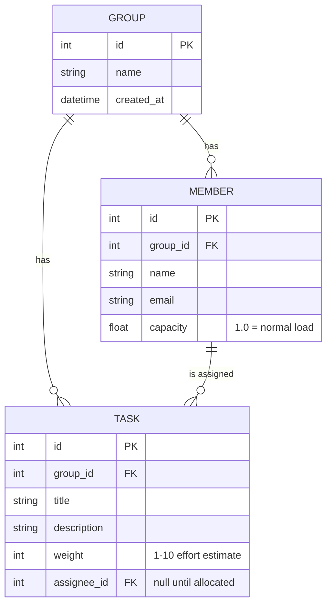

# Entity Relationship Diagram

## Design notes

**Why capacity sits on Member rather than a separate table.** Capacity is
per-sprint in the full vision, which would need its own table keyed by sprint.
For the MVP there is one allocation round, so a single column keeps it simple.
Moving it later is a migration, not a redesign.

**Why assignee_id is nullable.** Tasks exist before they are allocated, and a
group may deliberately leave one unassigned. `ON DELETE SET NULL` means removing
a member returns their tasks to the pool rather than deleting the work.

**Why the weight check is in the database.** The Pydantic schema validates it too,
but the constraint belongs with the data — a bad weight silently corrupts every
future allocation, and that is worth catching at both layers.
